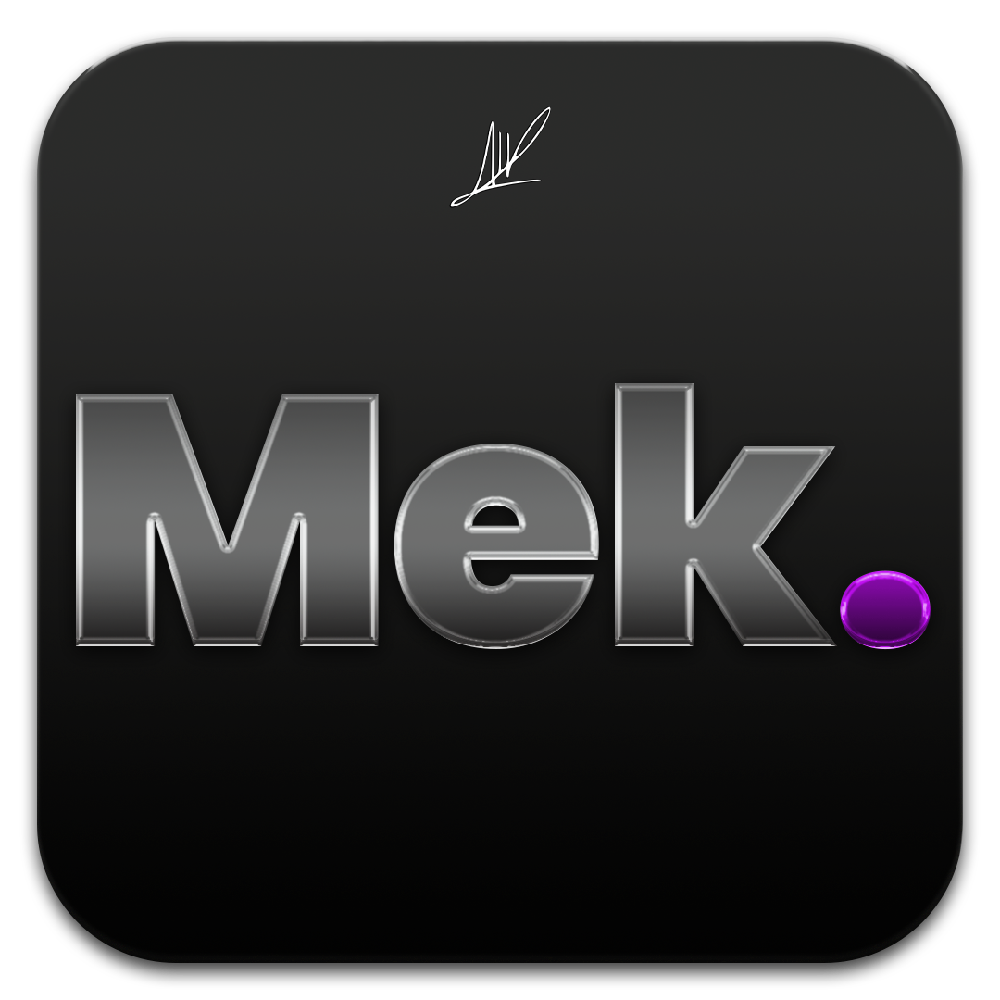

<p align="center">
  
</p>

<h1 align="center">Mek</h1>

<p align="center">
  Apple Silicon Mac'i kendi kendine en hızlı, en sağlıklı, en temiz ve en güvenli hâlde tutan; gün içinde
  takvimden, piyasalardan ve havadan haber veren arka plan asistanı. Apple Intelligence ile çalışır.
  <br><br>
  
  
  
  
</p>

> **v0.0.1.0:** Apple Intelligence Vision & Color Grading Motoru (Matrix, Oppenheimer, Blade Runner vb. film rengi emülasyonu, görselden renk klonlama, doğal dille efekt sentezi), Otonom Kaba Kurgu Motoru (FCPXML / CMX 3600 EDL), TTS için Türkçe fonetik "Epıl" telaffuz optimizasyonu ve Siri yanıt vermeme/kilitlenme kalkanı devrede. Önceki sürümler: [`v0.0.0.9`](https://github.com/AlptugDag/Mek/tree/v0.0.0.9), [`v0.0.0.8`](https://github.com/AlptugDag/Mek/tree/v0.0.0.8).

*English summary: an always-on background daemon for Apple Silicon Macs. It keeps performance, health, storage
and security at their best with no user input, and proactively speaks Turkish updates (calendar, markets,
weather, system). Text is phrased on-device by Apple Intelligence (FoundationModels). It never listens.*

---

## Konuştukları
Mek aşağıdaki durumlarda kendiliğinden konuşur:
- **Günün ilk karşılaması:** masaya oturduğunuzda selam ve Mek'in hazır olduğu hemen söylenir; hava, takvim, anımsatıcılar ve sistem özeti ardından gelir. Brifing piyasa özeti içermez.
- **Takvim:** etkinliklerden 10 dakika önce hatırlatma
- **Piyasalar (isteğe bağlı):** Yalnızca sizin izleme listenizdeki sembolleri kontrol eder ve kritik eşik aşıldığında haber verir. Liste boşken piyasa verisi çekmez; genel/kapanış özeti okumaz. Alım-satım yapmaz, tavsiye vermez.
- **Hava:** önümüzdeki 3 saat için yağmur uyarısı
- **Sistem:** biten renderlar, temizlik sonuçları, disk, ısı ve takas alanı uyarıları, uzun kurgu sonrası mola önerisi
- **Bilgisayar başında değilken:** olanları biriktirir, döndüğünüzde özetler

Şu durumlarda susar (acil güvenlik uyarıları hariç):
- 00:00–11:00 arası sessiz saatler
- Bir uygulama mikrofonu kullanıyorken (görüşme ya da kayıt)
- Siz bilgisayar başında değilken

Söyleyeceği cümleleri **Apple Intelligence**, cihaz üzerinde doğal Türkçeye çevirir; internet ya da API anahtarı gerekmez.
Ses [EMA Lightning](https://huggingface.co/canberkkkkkk/ema-lightning) ile ayrı bir süreçte üretilir, bu yüzden konuşma bitince bellek tamamen boşalır.

## Asistan (serbest sohbet)
- **Araç tabanlı:** Model komut çalıştırmaz, yalnızca tanımlı araçlardan birini seçer. Okuma araçları serbest, geri alınabilir eylemler (temizlik, sessize alma, süreci verimlilik çekirdeğine alma) otomatik, geri alınamaz olanlar sizin onayınızla çalışır. Her eylem `mek günlük`te "Asistan" etiketiyle görünür.
- **Cihaz üzerinde:** Varsayılan Apple Intelligence'tır; veri Mac'ten çıkmaz. Boşta hiçbir model çalışmaz, yalnızca soru gelince uyanır.
- **İsteğe bağlı Gemini:** Apple Intelligence yetmezse ya da soruya `derin` ile başlarsanız Gemini kullanılır. Bunun için `~/.jarvis/jarvis.json` içine `"gemini_api_key": "..."` ekleyin (`chmod 600`; isteğe bağlı `"gemini_model"`). Gemini'ye yalnızca sorunuz, kısa durum özeti ve araç çıktıları gönderilir. Anahtar yoksa bulut hiç kullanılmaz.
- **Sesle sorma:** Mikrofon sürekli dinlemez; yalnızca menüdeki "Sesle sor" tıklanınca en fazla 8 saniye açılır, çözümleme cihaz üzerinde yapılır.

## Akıllı Seslendirme ve Mac Studio Hoparlörü
- **Doğrudan Mac Studio Hoparlörü:** Mek tüm sesli bilgilendirmelerini kulaklık ya da harici monitör ses ayarlarından bağımsız olarak doğrudan Mac Studio'nun dahili hoparlörü üzerinden gerçekleştirir.
- **Oynatılan Medyayı Bölmeyen %30 Ses Seviyesi:** Hoparlörde o an müzik, video veya başka bir medya oynatılıyorsa, sistemin donanım ses düzeyine ASLA dokunulmaz (medyanızın sesi kısılmaz ya da artmaz). Mek, kendi sesini dijital sinyal seviyesinde akıllıca ölçekleyerek hoparlörün net %30 seviyesine denk gelen berrak bir güçte duyurur.
- **Günün İlk Karşılaması:** Sabah Alptuğ Bey masaya oturduğunda (ve hareket algılandığında), sessiz saat ayarından bağımsız olarak günaydın mesajı seslendirilir ve ardından günün ilk brifingi gelir.

## Dinamik Bellek Bütçesi ve Kurgu Optimizasyonu
- **Akıllı Kaynak Dağıtımı:** Premiere Pro, Photoshop, DaVinci Resolve ve Topaz Video gibi ağır uygulamalar aynı anda açık olsa bile bilgisayarın kasmaması için bellek bütçesi (`memory_budget.py`) açık uygulama sayısına göre otomatik kalibre edilir. Hiçbir uygulama tek başına tüm RAM'i işgal edip sistemi takas (swap) krizine sokamaz.
- **Sıfır Gecikmeli (<15 ms) Odak Geçişi ve E-Çekirdek Parkı:** Menü çubuğu uygulaması macOS `NSWorkspace` uygulama geçişlerini anında yakalar ve yerel Unix soketi üzerinden servise bildirir. `Cmd+Tab` ile Premiere Pro, Photoshop veya Topaz arasında geçiş yaptığınız anda:
  - Öne gelen uygulama anında arka plan kısıtından çıkarılır ve tüm **8 Performans çekirdeği (P-core)** ile en yüksek G/Ç önceliği ona tahsis edilir.
  - Arka planda kalan ve o an aktif render yapmayan diğer ağır uygulamalar **Verimlilik çekirdeklerine (E-core)** ve arka plan G/Ç katmanına park edilir; böylece boşta çalışan kurgu uygulamaları ön plandaki çalışmanızdan P-çekirdeği veya bellek bant genişliği çalamaz.
- **Adobe CEP / Eklenti ve Eşitleme Dizginleme:** Premiere Pro ve After Effects'in arka planda açtığı onlarca `CEPHtmlEngine` (Chromium eklenti paneli), `AdobeIPCBroker`, `CCXProcess` ve `Core Sync` süreci otomatik olarak Verimlilik çekirdeklerine (`taskpolicy -b`) ve düşük önceliğe (`nice +15`) sabitlenir.
- **Sıfır Sömürü (Non-Parasitic Tarama):** Süreçlerin değişmeyen yol/argüman bilgileri `(pid, create_time)` anahtarıyla önbelleklenir ve tüm modüller tek geçişli anlık görüntüyü paylaşır (`<%0.3` CPU tüketimi).
- **Bellek Rahatlatma (Memory Relief):** Uygulamalar arası geçişte veya bellek baskısı yükseldiğinde inaktif dosya önbelleği (`purge`) otomatik temizlenir. Arka planda uzun süredir hareketsiz kalıp gigabaytlarca RAM tutan bir uygulama varsa Mek nazikçe kapatma önerisi sorar.

## Apple Intelligence Vision, Sinematik Renk & Otonom Kurgu Motoru
Apple Silicon Mac Studio donanımı ve profesyonel kurgu ekosistemi, cihaz üzerindeki Apple Intelligence (`FoundationModels`) ve Vision motoru ile tek merkezden yönetilir:
- **Neural Conductor (Yapay Zekâ Orkestratörü):** Donanım telemetrisi (CPU, GPU, bellek basıncı, takas, termal profil) ile açık kurgu yazılımlarının durumunu tek geçişte analiz eder. Çoklu eylemleri anında planlar ve icra eder.
- **Sinematik Renk Derecelendirme & Film Emülasyonu (3D .cube LUT):**
  - `mek kurgu renk <film>`: İstediğiniz filmin ikonik renk paletini (*The Matrix, Blade Runner 2049, Oppenheimer, Amélie, Dune, Seven / Fincher, Wes Anderson, The Godfather, Kodachrome 64, Film Noir*) 33x33x33 3D `.cube` LUT olarak anında üretir. Hem DaVinci Resolve (`~/Library/.../LUT/Mek`) hem de Premiere Pro Lumetri (`~/Library/.../LUTs/Creative`) dizinlerine doğrudan kaydeder; DaVinci açıksa aktif klibe otomatik atar.
  - `mek kurgu klon <referans_görsel.jpg>`: Herhangi bir fotoğrafın veya film karesinin renk dağılımını (histogram ve renk momentleri) analiz ederek ona birebir uyan 3D LUT üretir.
  - `mek kurgu efekt "<doğal dil tarifi>"`: Apple Intelligence'a tarif ettiğiniz atmosferi (*"rüya gibi yumuşak parıltı (bloom), nostaljik soluk renkler ve 35mm film greni"*) ayrıştırır; renk derecelendirmesi ve optik efekt bileşenlerini (bloom, halation, grain, vignette) sentezleyip kurgunuza entegre eder.
- **Otonom Kaba Kurgu Motoru (FCPXML & CMX 3600 EDL):**
  - `mek kurgu kaba <dosya_veya_klasör>`: Ham video veya ses kayıtlarını milisaniye hassasiyetli RMS algoritmasıyla tarar. Nefes ve ölü boşlukları akıllı ses tamponları (80 ms pre-pad, 120 ms post-pad ile harf yutulmasını önleyerek) temizler.
  - Premiere Pro 2026, DaVinci Resolve Studio ve Final Cut Pro uyumlu standart **FCPXML** ve **CMX 3600 EDL** montaj çizelgesi oluşturur. DaVinci Resolve açıksa sekansı timeline'a otomatik yerleştirir.
- **Pro Kurgu Ortam Yönetimi:**
  - `mek kurgu durum`: Açık Premiere `.prproj` ve DaVinci Resolve Studio proje/timeline durumunu listeler.
  - `mek kurgu optimize`: 400 GB/s Ultra-Scratch RAM-diskini bağlar, P-çekirdek önceliğini kilitler, fanı Akıllı Sessiz kipe alır ve inaktif RAM'i boşaltır.
  - `mek kurgu render`: DaVinci Deliver render kuyruğunu başlatır.
  - `mek kurgu export`: Premiere sekansını Media Encoder kuyruğuna gönderir.
- **Menü Çubuğu ve Siri:** Menü çubuğuna eklenen `🎬 Video Kurgu (Apple Intelligence)` alt menüsü ve Siri sesli komutları ile renk derecelendirme, efekt sentezi ve kaba kurgu klavyesiz tetiklenir.
- **Doğal Türkçe Fonetik ("Epıl"):** EMA Lightning TTS motoru, "Apple" kelimesini ve tamlamalarını (Apple Intelligence, Apple Studio vb.) yabancı aksan bozulması olmadan akıcı ve net bir şekilde **"Epıl"** olarak seslendirir.
- **Siri Kilitlenme Kalkanı:** macOS 27 beta üzerinde çalışan Siri ve Siri AI süreçleri işlemci kaçak dizginleme kuralından tam muaf tutulur; arka plan QoS kısıtlamasına sokulmayarak yanıt vermeme hatası kesin olarak önlenir.

## Çökme Yönetimi ve Yetim Süreç Temizliği (Sessiz ve Otonom)
- **Gereksiz Okumaları Engelleme:** Arka planda çöken sistem veya yardımcı süreçlerinin (örn. `MxContentService`, `ExcUserFault` vb.) rapor adları kullanıcıya sesli okunarak vakit kaybı yaratılmaz.
- **Otonom Onarım ve Yetim Temizliği:** Çökme raporları sessizce `crash_reports.json` içine işlenir. Ana Adobe/kurgu uygulamaları kapandığında veya çöktüğünde bellekte asılı kalan yetim `CEPHtmlEngine`, `dynamiclinkmanager`, `AdobeQTServer`, `AI MACHINE Server` ve `Adobe Crash Processor` süreçleri ile geçici `.lock` dosyaları otomatik temizlenir. Kullanıcı dilediğinde `mek çökmeler` yazarak özeti metin olarak görebilir.

## Soru-Cevap Mekanizması ve Gerçek Siri Beta / Apple Intelligence Entegrasyonu
- **Net Seçenekler:** Mek bir konuda karar gerektiğinde açık seçeneklerle sorar (örn. `kapat` / `dokunma`). Seçenekler seslendirilir ve anlaşılır yanıt beklenir.
- **Kestirmesiz (Shortcuts'sız) Doğrudan Sistem Entegrasyonu:**
  - `/Applications/Mek.app` sisteme **App Intents** ile bağlıdır. Kestirmeler (Shortcuts)
    uygulamasında hiçbir şey kurmanız, açmanız ya da oluşturmanız gerekmez; komutlar
    doğrudan Siri'nin kendi komut dizinine kaydolur. Ayrıca AppleScript Scripting Suite
    (`Mek.sdef`) ve `mek://` protokolü de kullanılabilir.
  - **Sesle:** *"Hey Siri, Mek"* (Mek ne istediğinizi sorar), *"Hey Siri, Mek durum"*,
    *"Hey Siri, Mek brifing"*, *"Hey Siri, Mek temizlik yap"*,
    *"Hey Siri, Mek karantinada ne var"*, *"Hey Siri, Mek kurgu modu"*,
    *"Hey Siri, Mek kurgu durumu"*, *"Hey Siri, Mek'e sor [sorunuz]"*.
  - **Yazarak:** Sistem Ayarları → Erişilebilirlik → Siri → **"Siri'ye Yazın"** açıkken
    Siri'yi çağırıp aynı cümleleri yazabilirsiniz.
  - Terminalden: `mek cevap kapat`, `mek evet`, `mek hayır`
  - Menü çubuğundan: Soru olduğunda menü `Mek ❓` simgesini alır ve tek tıkla yanıtlanabilir butonlar sunar.
  - **Sıfır Mikrofon Çakışması:** Yeni Siri Beta (`Siri AI.app` / `CampoRemoteService`) ve Apple Intelligence mikrofonu kullandığında Mek asla kendini sessize almaz, süreçler birbirini engellemeden pürüzsüz çalışır.

## Performans
- **Kurgu sırasında:** Premiere, After Effects, Resolve, Topaz veya Media Encoder açıldığında devreye girer.
  - Bu uygulamaları en yüksek önceliğe alır.
  - Bulut eşitleme, güncelleyici ve indeksleme gibi işleri verimlilik çekirdeklerine iter.
  - Gereksiz servisleri geçici olarak durdurur, uykuyu ve Power Nap'i engeller.
  - Uygulamalar kapanınca her şeyi eski hâline döndürür.
- **M serisi güç modu:** Gerçek CPU/GPU overclock, voltaj veya frekans ayarı yapılmaz. macOS cihazda `highpowermode` destekliyorsa yalnızca AC gücünde render profili sırasında açılır; önceki AC ayarı kaydedilip normale dönüşte veya sonraki servis başlangıcında geri yüklenir.
- **Kaçak süreçler:** Kurgu programı olmayan bir süreç işlemciyi uzun süre yorarsa onu verimlilik çekirdeklerine alır.
- **Ağ:** Varsayılan arayüz, gateway/internet gecikmesi, paket kaybı ve arayüz trafik sayaçlarını izler. Bağlantı bozulunca örnekleme sıklaşır, sağlıklıyken seyrekleşir; yük veya kayıpta öneri verir. DNS, rota, MTU ve süreç durumunu otomatik değiştirmez.
- İsteğe bağlı `mek ağ test`, macOS `networkQuality` ile indirme/yükleme kapasitesi ve responsiveness ölçer. Aktif test kısa süreli bant genişliği kullanır; kendiliğinden çalışmaz.
- Python runtime modülleri sistem, ağ, güç, crash, güvenlik, takvim, bakım ve güncelleme olaylarını `events.py` üzerinden Mek coordinator'ına iletir; bildirim ve TTS bu olaylardan beslenir.
- **Kendi yükü:** yaklaşık 70–90 MB bellek. Kontrol sıklığı duruma göre değişir: kurgu sırasında 15 saniye, siz bilgisayar başındayken 10 saniye, uzaktayken 45 saniye.

## Depolama temizliği
| Katman | Ne zaman | Kapsam |
|---|---|---|
| Günlük | Siz bilgisayar başında değilken ve render yokken | Adobe, DaVinci, Topaz, Lightroom, Capture One önbellekleri; bütün uygulama önbellekleri (App Store uygulamaları ve Electron tabanlılar dahil); tarayıcılar; kayıtlar, çökme raporları, geçici dosyalar |
| Haftalık | Haftada bir | Günlük katman + Homebrew, npm, pip, Xcode, Docker + sistem önbellekleri ve kayıtları + rapor |
| Acil | Boş alan 60 GB'ın altına düşünce | Yaş eşikleri düşer, Time Machine yerel anlık görüntüleri inceltilir |

**Asla silinmeyenler:**
- DaVinci renk stilleri ve proje yedekleri
- Son 30 günün otomatik kayıtları
- Yapay zekâ modelleri
- Fotoğraflar, Mail ve Mesajlar verisi

Eski kurulum dosyaları ve aylardır açılmamış büyük dosyalar silinmez, yalnızca size raporlanır.

## Disk sağlığı ve reklam engelleme
- SMART durumu boşta altı saatte bir okunur; dosya sistemi haftada bir `diskutil verifyVolume` ile doğrulanır. Denetimler salt okunurdur; hata bulunursa bildirim gönderilir, onarım otomatik başlatılmaz. Bazı Apple SSD'lerinde SMART bilgisi sunulmadığından bu durum arıza kabul edilmez.
- Sistem genelinde reklam engelleme isteğe bağlı hosts listesi kullanır. `mek reklam aç` etkinleştirir, `mek reklam güncelle` listeyi indirip yeniler, `mek reklam kapat` yalnızca Mek'in işaretli bölümünü kaldırır; `mek reklam durum` durumu gösterir. Hosts dosyasının diğer satırları korunur.
- Etkinleştirme ve güncelleme StevenBlack hosts listesini HTTPS üzerinden indirir ve yönetici yardımcısını gerektirir. Başka uygulama ve VPN'ler kendi DNS/HTTPS-over-DNS yapılandırmalarıyla engellemeyi aşabilir; aynı alan adından sunulan reklamlar da hosts yöntemiyle ayrılamaz.
- Mevcut kurulumda önce proje klasöründen `./install.sh`, ardından yeni helper komutlarını yüklemek için `sudo bash ~/.jarvis/jarvisd/install_privileged.sh` çalıştırın.

## Yazılım ve donanım güncellemeleri
- Mek günde en fazla bir kez; kullanıcı 15 dakikadan uzun süredir boşta, render yok, AC güç bağlı, en az 30 GB boş alan var, termal durum normalse ve ağda açık bir bağlantı sorunu görünmüyorsa otomatik güncelleme kurar.
- macOS'in önerdiği aynı ana sürüm güvenlik/sistem güncellemeleri ve Apple firmware güncellemeleri `softwareupdate` ile kurulur. Büyük macOS sürüm yükseltmeleri ve otomatik yeniden başlatma yapılmaz.
- Homebrew formula/cask güncellemeleri ve `mas` yüklüyse Mac App Store uygulamaları kontrol edilir. Sabitlenmiş paketler atlanır; açık GUI uygulamalarının cask/App Store güncellemeleri ertelenir. Cask uygulama adı bulunamazsa o cask güvenlik için ertelenir.
- USB/Thunderbolt aygıtları üretici/model/raporlanan firmware sürümüyle envantere alınır. Apple firmware'i Apple güncelleme kataloğundan gelir; üçüncü taraf çevre birimi firmware'ini güvenli ve genel bir macOS arayüzüyle kurmak mümkün değildir, bu nedenle üretici aracı gerekir.
- Mevcut kurulumda önce `./install.sh`, sonra güncel root helper için `sudo bash ~/.jarvis/jarvisd/install_privileged.sh` çalıştırın.

## Güç kesintisi ve sesli bildirimler
- `mek güç` macOS güç kaynağını ve görülebilen UPS telemetrisini raporlar. Masaüstü bilgisayarı gerçek kesintiden korumak için USB/HID uyumlu UPS gerekir; UPS telemetrisi yoksa Mek kesintiyi önleyemez.
- Pil/UPS kaynağına geçişte, güç geri geldiğinde ve UPS kritik seviyeye indiğinde Mek TTS ile uyarır. Kritik seviyede kapatma varsayılan olarak kapalıdır. İsteğe bağlı açmak için `~/.jarvis/jarvis.json` dosyasına `"ups_auto_shutdown_enabled": true` ekleyin; yalnızca raporlanan UPS deşarj oluyor ve yüzde 15 veya 5 dakika eşiğinin altındaysa bir dakikalık zarif kapatma planlanır. Bu arada AC geri gelirse Mek'in planladığı kapatma iptal edilir.
- Activity Monitor raporları, çökmeler, güç, güncelleme ve güvenlik bildirimleri ortak Mek event kanalından TTS bildirimlerine aktarılır. `mek etkinlik sesli` anlık CPU/bellek özetini seslendirir.

## Güvenlik
- **Kripto madenciler ve Bilgi Hırsızları (Stealer Kalkanı):** İmza, komut satırı (`with hidden answer` sahte parola penceresi, `dump-keychain`, `Cookies`/`Login Data` hırsızlığı, `base64 | sh`) ya da havuz bağlantısıyla tespit edilir. Süreç anında durdurulur, dosyası ve onu başlatan ajan karantinaya alınır.
- **İndirilenler ve Masaüstü Ön-Kapı Denetimi (`~/Downloads` & `~/Desktop`):** Hem İndirilenler hem de Masaüstü klasörüne yeni düşen `.command`, `.sh`, `.tool`, `.dmg` ve `.pkg` dosyaları daha çalıştırılmadan önce arka planda (E-çekirdeklerde) taranır.
- **Başlangıç Öğeleri ve Kabuk/Cron Denetimi:** Yeni eklenen `LaunchAgents` öğeleri ile `~/.zshrc`, `~/.zprofile`, `~/.bash_profile`, `~/.bashrc` ve `crontab` değişiklikleri 15 dakikada bir denetlenir.
- **Özel/Ad-Hoc Kurgu ve Eklenti Koruması:** `/Applications`, `/Library/Application Support/Adobe`, `Plug-ins`, `VST3`, `Audio/Plug-Ins` ve `OFX` altındaki özel/yama uygulanmış kurgu programları ve eklentiler korunur; yanlış alarmla karantinaya alınmaz ve Homebrew güncellemelerinde üzerine yazılmaz.
- **Dosya taraması:** ClamAV, siz bilgisayar başında değilken yeni indirmeleri en düşük öncelikte tarar; virüs veritabanı günde bir kez güncellenir.
- **Güvenlik ayarları:** SIP, Gatekeeper, FileVault, güvenlik duvarı ve XProtect izlenir. Mek bu ayarları değiştirmez, kapanırsa size söyler.
- Hiçbir dosya silinmez. Şüpheli dosyalar `~/.jarvis/karantina` klasörüne taşınır.

## Kurulum

Komut artık `mek`; eski kurulumlarla uyum için kullanıcı verisi ve daemon yolları `~/.jarvis` altında korunur.

```bash
git clone https://github.com/AlptugDag/Mek.git && cd Mek
./install.sh
sudo bash ~/.jarvis/jarvisd/install_privileged.sh   # güç profilleri + sistem temizliği (sabit komutlar)
```
İlk çalıştırmada macOS, Takvim ve Anımsatıcılar için izin ister.

**Terminal komutları:**
- `mek brifing`: brifingi hemen okur
- `mek durum`: anlık sistem durumu
- `mek piyasa thy`: belirli bir hissenin fiyatı
- `mek izleme`: izleme listesini ve kritik değişim eşiklerini gösterir
- `mek izleme ekle THYAO.IS AAPL`: yalnızca seçtiğiniz sembolleri kritik değişimler için izler
- `mek izleme çıkar AAPL`: sembolü listeden çıkarır; liste `~/.jarvis/jarvis.json` dosyasına kaydedilir
- `mek güvenlik`: güvenlik özeti
- `mek etkinlik [aç|sesli]`: Activity Monitor özeti, yerel uygulamayı açma veya TTS özeti
- `mek çökmeler`: son uygulama çökme raporları
- `mek güç`: AC/UPS güç durumu
- `mek güç koruma`: otomatik UPS kapatmanın açık/kapalı durumunu gösterir
- `mek temizle [derin]`: temizliği elle başlatır
- `mek disk`: disk SMART durumunu gösterir
- `mek sor <soru>` ya da doğrudan `mek bilgisayar neden yavaş?`: serbest Türkçe soru. Mek ölçer, tanımlı araçlarla eyleme geçer ve cevaplar. Menü çubuğunda "Mek'e sor veya komut ver…" ve "Sesle sor" öğeleri de var.
- `mek onay` / `mek iptal`: onay gerektiren eylemleri (uygulama kapatma, güncelleme kurma, reklam engeli, karantinadan geri alma) siz onaylar ya da reddedersiniz; model kendi kendine onay veremez.
- `mek karantina`: karantinaya alınanları numaralı listeler; `mek karantina geri <no>` yanlış alarmı yerine koyar ve bir daha şüpheli saymaz
- `mek günlük [adet]`: Mek'in son kendiliğinden eylemleri (söyledikleri, arka plana aldığı süreçler, karantina, güncelleme)
- `mek ağ`: arayüz durumu, yaklaşık trafik ve ping kalitesini gösterir
- `mek ağ test`: isteğe bağlı aktif indirme/yükleme kalite testi
- `mek güncelle kontrol`: Apple, Homebrew ve varsa Mac App Store güncellemelerini listeler
- `mek güncelle şimdi`: yalnızca güvenli bakım penceresi açıksa güncellemeleri kurar
- `mek güncelle durumu`: son otomatik güncelleme sonucunu gösterir
- `mek güncelle donanım`: bağlı USB/Thunderbolt aygıtlarını ve raporlanan firmware sürümlerini gösterir
- `mek reklam [durum|aç|güncelle|kapat]`: hosts tabanlı sistem geneli reklam engellemeyi yönetir
- `mek kaldır /Applications/Uygulama.app`: uygulamayı ve kullanıcı Library'sindeki doğrudan ilişkili kalıntıları önizler; silme için bundle ID onayı ister. Uygulama önceden kaldırıldıysa bundle ID kullanılabilir.
- `mek sus 60`: 60 dakika sessiz kalır
- `mek log`: kayıtları izler

Uygulama kaldırma; cache, tercihler, destek dosyaları, sandbox container'ları ve uygulamaya ait kullanıcı başlangıç ajanları gibi bundle ID ile doğrudan eşleşen öğeleri kapsar. Paylaşılan Group Container'lar, kullanıcı belgeleri ve yönetici yetkisi gerektiren sistem öğeleri bilerek kapsam dışındadır.

**Siri ile doğrudan kullanım:** Siri'ye *"Hey Siri, Mek"* demeniz yeterlidir; Mek ne
istediğinizi sorar. Hazır cümleler: *"Mek durum"*, *"Mek brifing"*, *"Mek temizlik yap"*,
*"Mek karantinada ne var"*, *"Mek kurgu modu"*, *"Mek kurgu durumu"*,
*"Mek'e sor [sorunuz]"*. Hiçbir Kestirme (Shortcut) kurulumu gerekmez.

### Siri entegrasyonu nasıl çalışıyor (teknik)

macOS'ta bir uygulamanın komutlarının Siri tarafından görülmesi için paketin içinde
`Contents/Resources/Metadata.appintents/` klasörü bulunmalıdır. Bu klasörü normalde
Xcode'un `appintentsmetadataprocessor` aracı üretir ve bu araç yalnızca tam Xcode
kurulumuyla gelir.

Mek bunu Xcode olmadan çözer:

1. `swiftc`, `-emit-const-values` ile `ui/MekMenuBar.swift` içindeki App Intents
   tiplerinin tüm derleme zamanı bilgisini (mangled tip adları, parametreler, Siri
   cümleleri) bir `.swiftconstvalues` dosyasına yazar.
2. [`bin/appintents_metadata.py`](bin/appintents_metadata.py) bu dosyayı macOS'un
   beklediği `extract.actionsdata` (biçim sürümü 3.0) + `version.json` ikilisine
   çevirir — yani Xcode aracının yerini alır.
3. [`bin/build_mek_app.sh`](bin/build_mek_app.sh) paketi kurar, imzalar, karantina
   damgasını siler ve `lsregister` ile kaydeder.

Sonuç `linkd` (macOS'un App Intents dizinleyicisi) günlüğünden doğrulanabilir:

```bash
log show --last 5m --predicate 'process == "linkd"' | grep com.alptug.mek
```

`Inserting canonical bundle` satırı, komutların Siri dizinine girdiğini gösterir.
Yalnızca `/Applications/Mek.app`'i yeniden derlemek için: `make app`.

> **Not:** macOS, App Intents meta verisini yalnızca "güvenilir" paketlerden okur.
> Yerel derlemede bu, karantina damgasının olmaması ve uygulamanın en az bir kez
> çalışmış olması demektir; `install.sh` ikisini de halleder.

Mek mikrofondan sürekli dinlemez. Ona verilecek komutlar, ayarlar ve izleme tercihleri terminalde `mek ...` komutlarıyla, Siri üzerinden veya menü çubuğundan iletilir. Sistem eylemleri bu komutlar ve güvenli, tanımlı bakım kurallarıyla sınırlıdır; keyfî terminal komutları üretip çalıştırmaz.

Mek, kurulumdan sonra macOS menü çubuğunda görünür. Menüden brifing, sistem/güç durumu ve izleme listesi açılabilir; **Mek'e komut ver…** alanından desteklenen bir komut veya izleme tercihi gönderilebilir. Bu pencere arka plan servisine yerel Unix soketi üzerinden bağlanır; komutlar bu cihazda kalır.

## Yapı
```
jarvisd/jarvisd.py    ana servis: olaylar, brifing, bildirim, zamanlama
jarvisd/services.py   performans profilleri, QoS, servis yönetimi
jarvisd/context.py    ön plandaki uygulama, boşta kalma süresi, GPU, render takibi, ısı
jarvisd/apple.py      Takvim/Anımsatıcılar (EventKit), piyasalar, Türkçe tarih ayrıştırma
jarvisd/security.py   madenci, kalıcılık, ClamAV, güvenlik ayarları, karantina
jarvisd/cleaner.py    katmanlı depolama temizliği
jarvisd/activity_monitor.py süreç özeti, Activity Monitor ve crash raporları
jarvisd/power_guard.py UPS/güç olayları ve isteğe bağlı güvenli kapatma
jarvisd/events.py     runtime modülleri için olay kanalı
jarvisd/network_optimizer.py  adaptif ağ sağlığı, trafik ve isteğe bağlı kapasite ölçümü
jarvisd/updater.py    Apple, Homebrew/MAS güncellemeleri ve USB/Thunderbolt envanteri
ui/MekMenuBar.swift   macOS menü çubuğu ve komut penceresi
ai/jarvis-ai.swift    Apple Intelligence (FoundationModels) köprüsü
jarvis.py             ses (EMA Lightning + Mac Studio hoparlör EQ), hava durumu
```

## Lisans
MIT
